# NOVA — turn your PC into a console

[Français](README.md) · **English** · 🌐 [NOVA website](https://head69100.github.io/nova/en/)

NOVA is a full-screen interface to launch your PC games **with a controller**, just like a living-room console.
Install it, plug in your controller, and find all your games (Steam, Epic, GOG, Ubisoft, EA and your own game folders) in one place.

> NOVA is independent software. It is not affiliated with or endorsed by Sony, Microsoft, Valve or the publishers of the games shown.
> The interface is available in **English and French**: pick your language in the installer (you can change it later in Settings › System › Language).

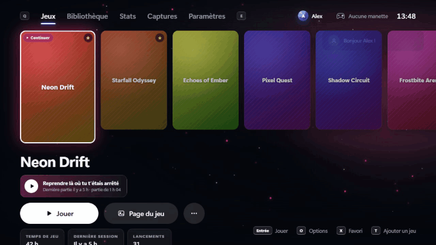

<a href="https://github.com/head69100/nova/releases/latest"><b>⬇️ Download NOVA (free)</b></a>

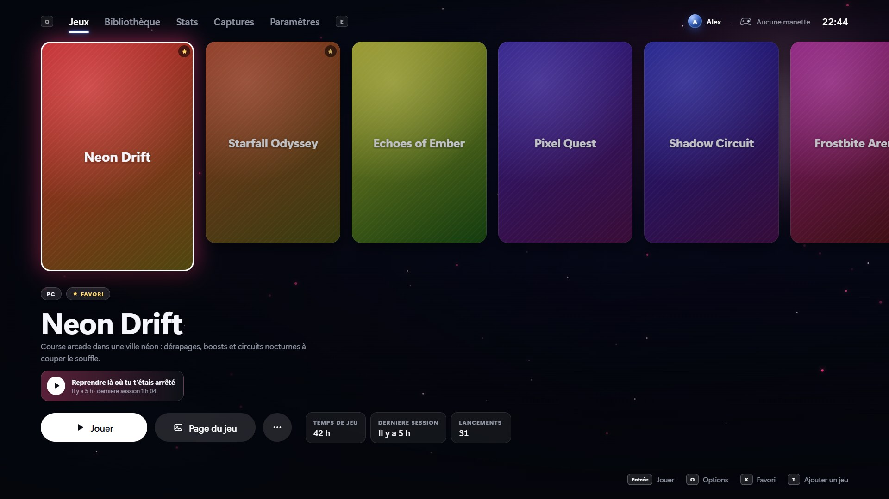

## 📸 Screenshots

| | |
|---|---|
| 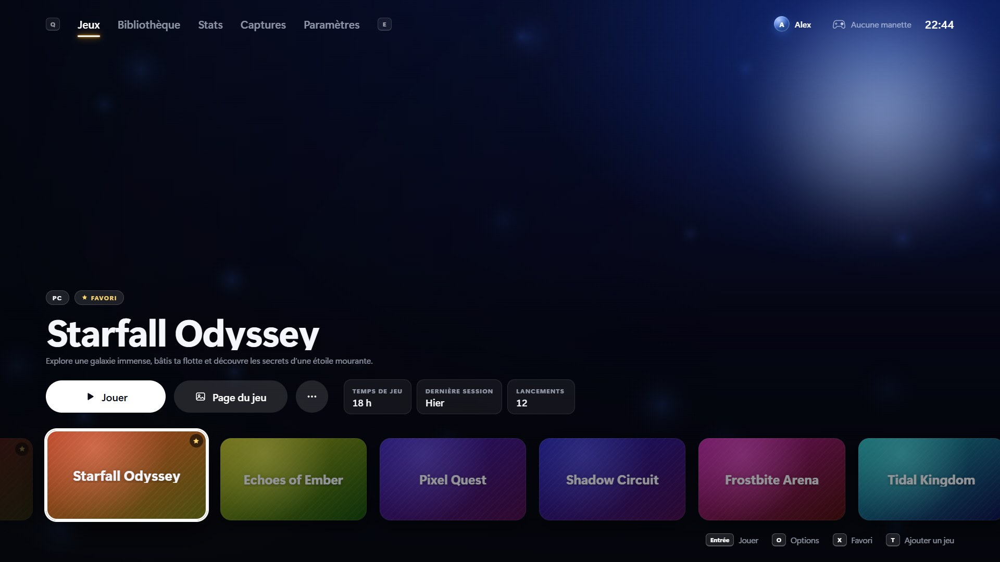 **Showcase theme**: the game in full screen | 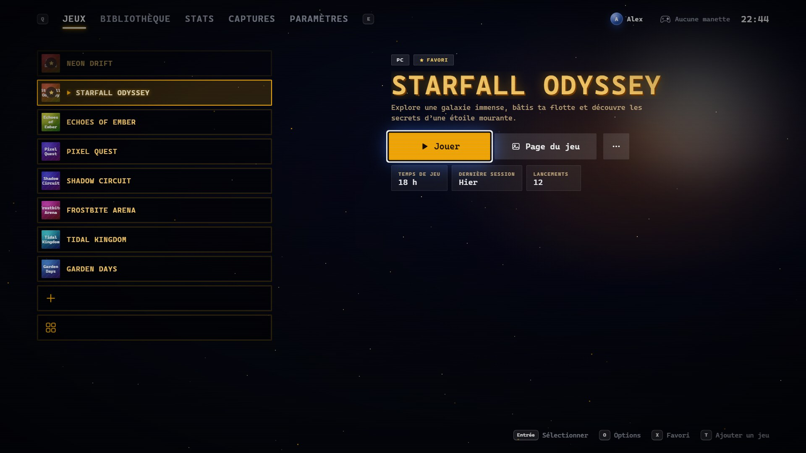 **Retro arcade theme**: an arcade-cabinet style menu |
| 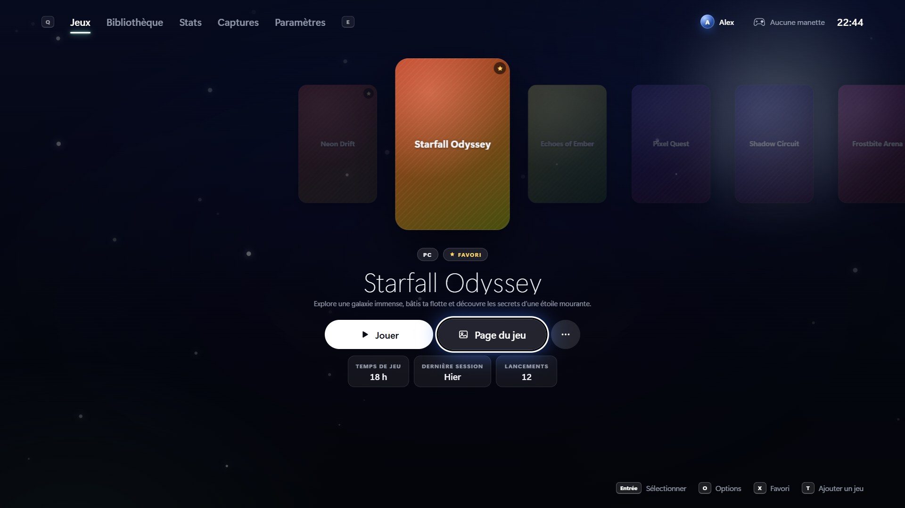 **Zen theme**: one big cover in the middle | 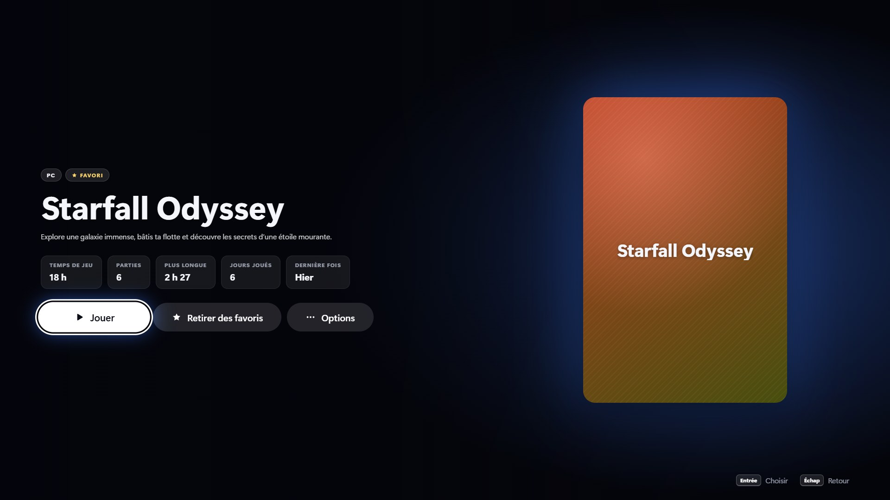 **Game page**: stats and recent sessions |
| 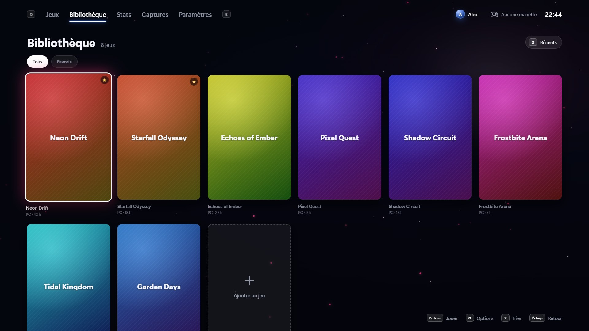 **Library**: all your games, sorted your way | 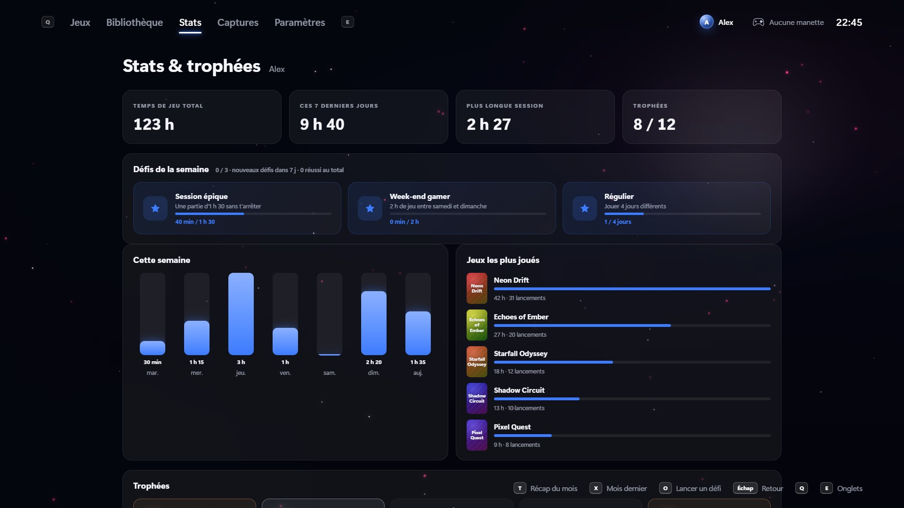 **Stats**: play time, weekly challenges, trophies |
| 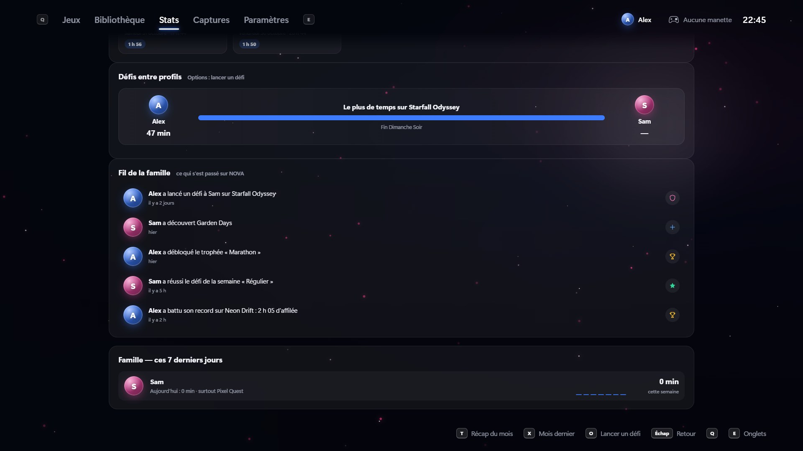 **Family**: challenges between profiles and a family feed | 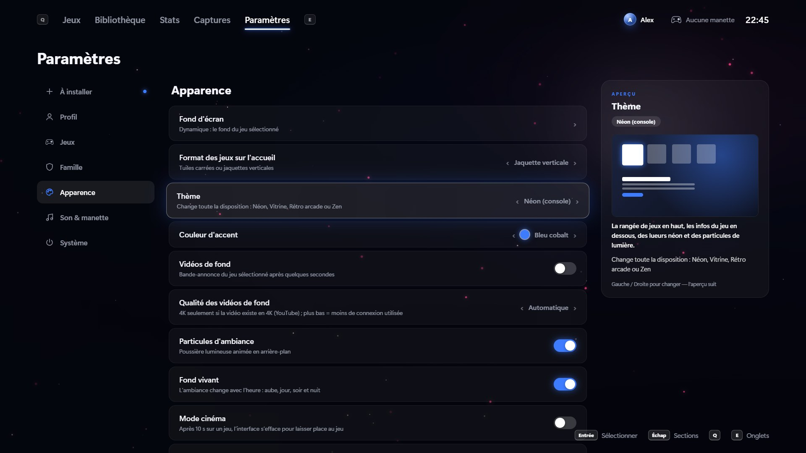 **Settings**: every option explained |

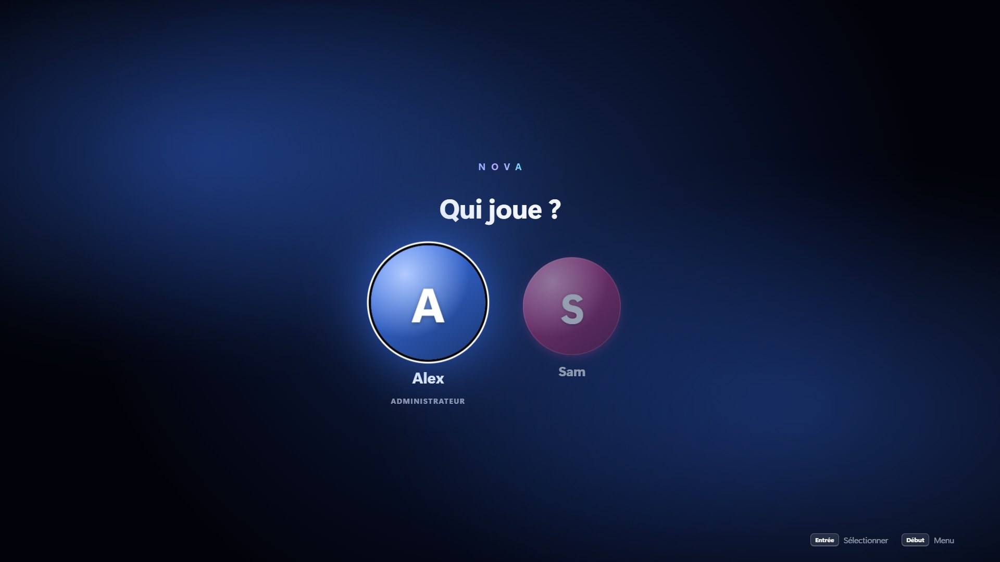 <em>Several profiles, with PIN codes and parental controls</em>

Screenshots taken with a demo library (made-up games).

## 🌌 NOVA online: your constellation

Meet your friends **without leaving your console**, with an interface built for controllers (nothing like a desktop chat app).

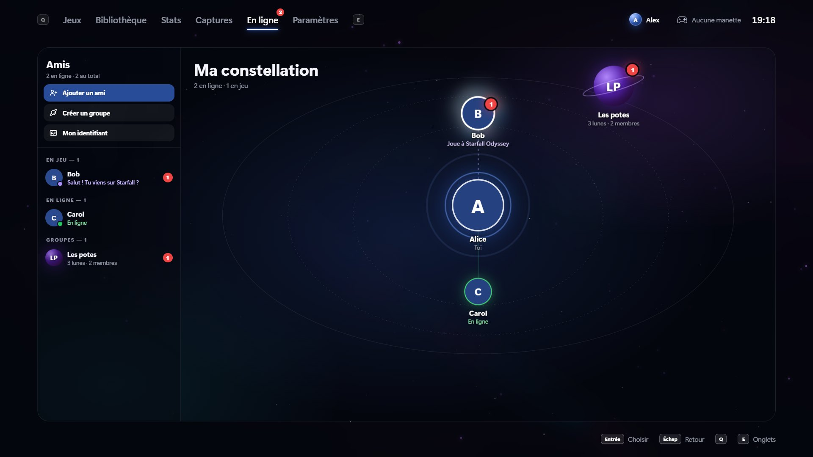

- **Adding friends, made simple**: just type their username (NOVA shows you the account it found before sending), or send your **friend link**: in one click it opens in NOVA and your friend adds you.
- **Your constellation**: your friends are stars around you. The ones playing glow in their game's colors, and your groups are planets. The **Friends** column gives the full list, sorted by status.
- **Groups and moons**: each group has its **moons**, one per game or topic, with the game's cover as a backdrop and the friends playing it. The **crew** (members) is shown, and every member gets access to every moon.
- **"Tonight at 9 pm?"**: suggest a session, and your friends answer "I'm in" or "Can't" right on the card.
- **The wheel**: Triangle opens a wheel of quick messages that you aim with the stick. And **mid-game**, PS + touchpad opens the wheel over the game so you can message a friend without quitting.
- **End-to-end encrypted messages**, in-game notifications, reactions, shared screenshots.
- **Open and free**: NOVA uses the **Matrix** network (free account on matrix.org). Your friends can also reply from Element or any Matrix app. NOVA stays 100% local until you sign in.

| | |
|---|---|
| 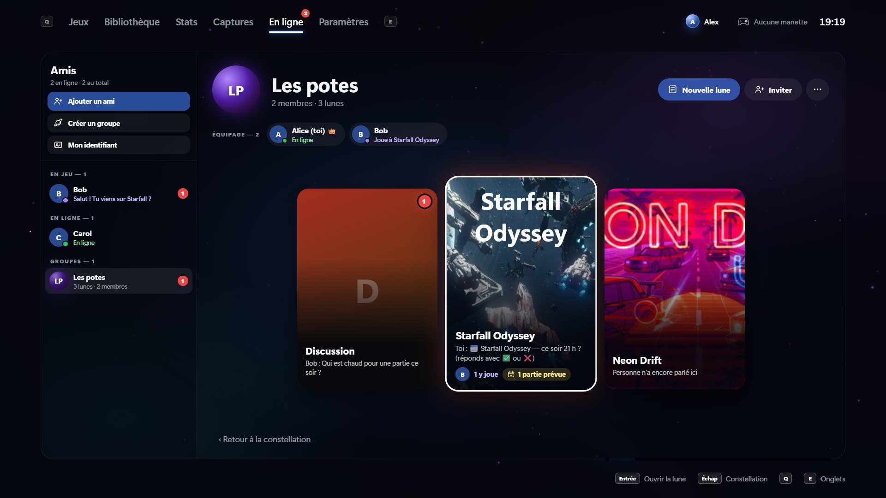 **A group**: its crew and moons, one per game | 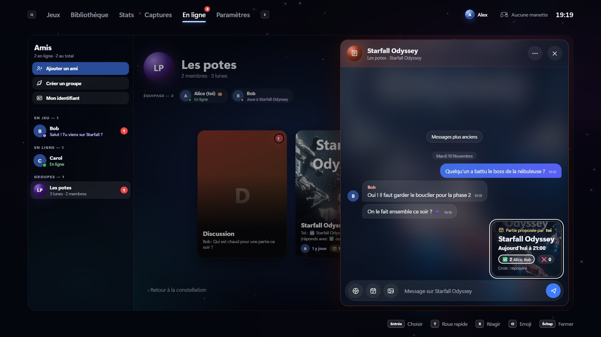 **A conversation**: with a session planned for tonight |

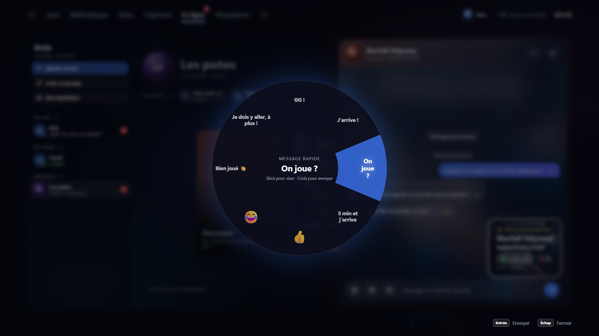 <em>The quick message wheel, aimed with the stick</em>

Online screenshots are shown with the French interface.

## ✨ What NOVA does

- **All your games in one place**: automatic detection, with covers, backgrounds, logos and trailers fetched for you.
- **Built for controllers**: DualSense, DualShock 4 and Xbox controllers. Battery level, rumble, and a light bar that matches the game.
- **Virtual Xbox controller** for games that don't recognize the DualSense.
- **Profiles** with PIN codes, avatars, parental controls, separate saves per profile and a guest profile.
- **Play on your TV** (with Sunshine and Moonlight): a controller shortcut turns on the TV and shows NOVA on it — and mid-game you can switch from the PC screen to the TV without quitting.
- **Family**: night mode, player 2 tracked when two controllers play, couch co-op game list.
- **NOVA online**: friends, groups and moons, encrypted messages, a message wheel even in game (see above).
- **Your phone** (QR code): a second screen during play, or a controller for a friend, with nothing to install.
- **Cloud saves** (OneDrive, Google Drive, Dropbox or a USB drive) and **mods per profile**.
- **Stats, trophies, weekly challenges, monthly recap and a journal** of your sessions.
- **Controller and keyboard shortcuts**: screenshot, 30-second replay, in-game overlay with temperatures, pause…
- **Themes** that change the whole layout: Neon, Showcase, Retro arcade, Zen.
- **Built-in updates**: NOVA lets you know and updates itself without reinstalling.

## 📥 Installation

1. Go to **[Releases](https://github.com/head69100/nova/releases/latest)** and download `NOVA-Setup-x.y.z.exe`.
2. Run the installer.
   Windows may show "Windows protected your PC": click **More info** then **Run anyway** (the installer isn't code-signed yet).
3. Open NOVA, create your profile, and let NOVA find your games.

**Requirements**: Windows 10 or 11 (64-bit). A controller is recommended (keyboard and mouse work too).

## 🔄 Updates

NOVA checks for new releases published here and offers to install them
(Settings › System › Updates and history). Release notes are written in French: see the [changelog](CHANGELOG.md).

## ❤️ Support NOVA

NOVA is free. If you'd like me to keep improving it, you can support the project with the **Sponsor** button at the top of this page. Thank you!

Don't want to miss anything? Click ⭐ **Star** and 👁 **Watch** at the top of the page.
Questions or ideas? Join the [Discussions](https://github.com/head69100/nova/discussions).

## ⚖️ License

NOVA is free but **not open-source**: all rights reserved.
You can install and use it for free, but you may not modify, resell or redistribute it.
See [LICENSE](LICENSE.md) and the [third-party credits](CREDITS.md).
