# NOVA — ton PC devient une console

**Français** · [English](README.en.md) · 🌐 [Site de NOVA](https://head69100.github.io/nova/)

NOVA est une interface plein écran pour lancer tes jeux PC **à la manette**, comme sur une console de salon.
Installe-la, branche ta manette, et retrouve tous tes jeux (Steam, Epic, GOG, Ubisoft, EA et tes dossiers de jeux) dans une seule interface.

> Interface en **français ou en anglais** : la langue se choisit dans l'installateur (et se change dans Paramètres › Système › Langue).
>
> NOVA est un logiciel indépendant. Il n'est ni affilié, ni approuvé par Sony, Microsoft, Valve ou les éditeurs des jeux cités.

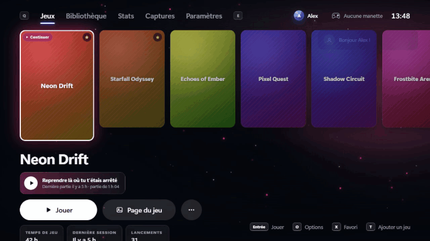

<a href="https://github.com/head69100/nova/releases/latest"><b>⬇️ Télécharger NOVA (gratuit)</b></a>

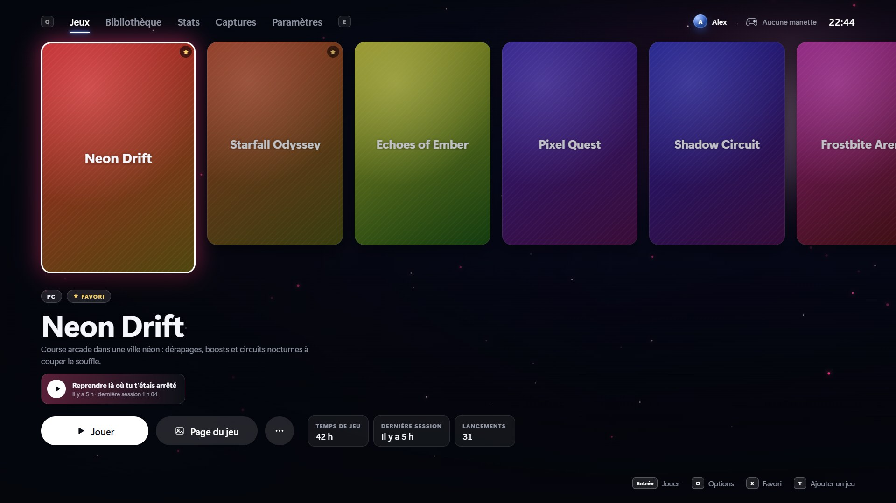

## 📸 Aperçu

| | |
|---|---|
| 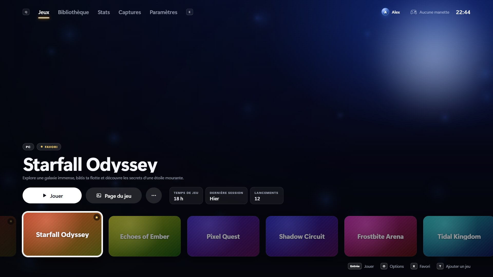 **Thème Vitrine** : le jeu en grand écran | 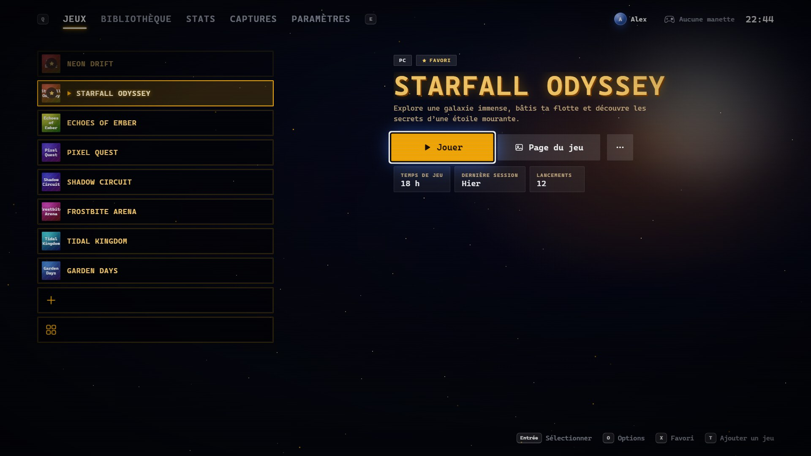 **Thème Rétro arcade** : menu façon borne d'arcade |
| 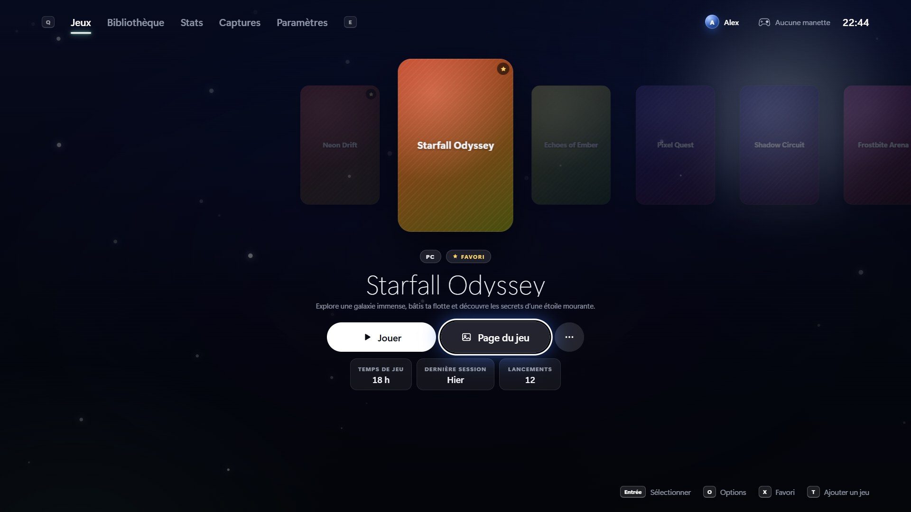 **Thème Zen** : une grande jaquette au centre | 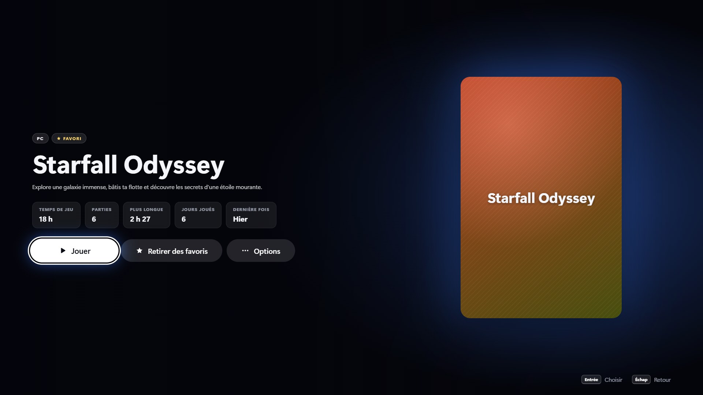 **Page du jeu** : stats et dernières parties |
| 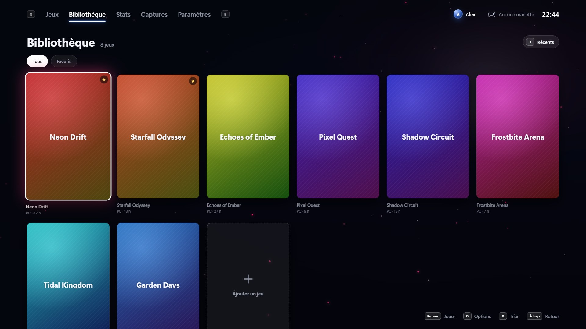 **Bibliothèque** : tous tes jeux, triés comme tu veux | 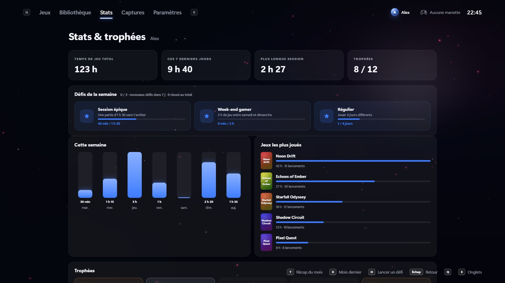 **Stats** : temps de jeu, défis de la semaine, trophées |
| 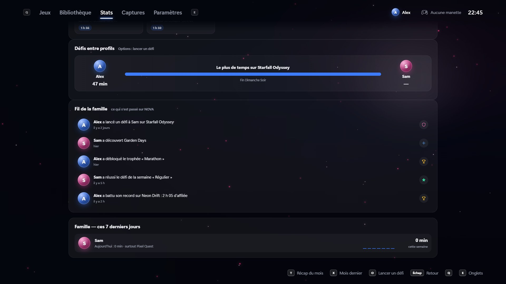 **Famille** : défis entre profils et fil de la famille | 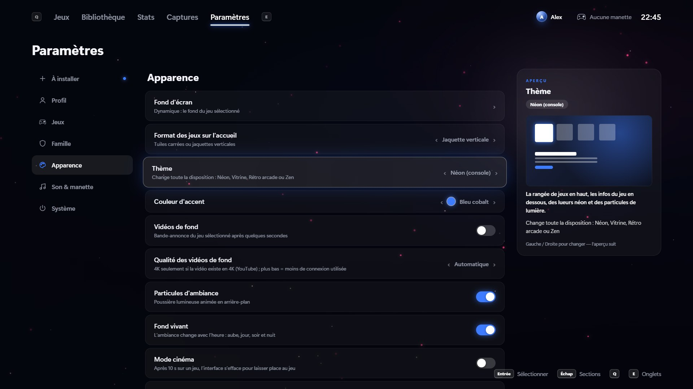 **Paramètres** : chaque réglage est expliqué |

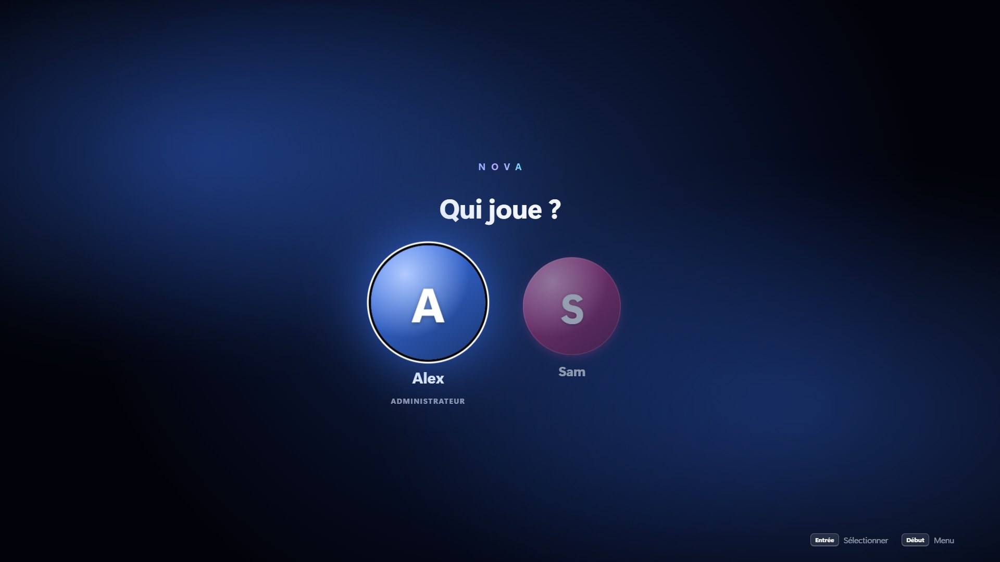 <em>Plusieurs profils, avec code PIN et contrôle parental</em>

Captures réalisées avec une bibliothèque de démonstration (jeux fictifs).

<!-- NOUVEAUTES:DEBUT -->
## 🆕 Dernières nouveautés

- **1.4.49** (10 novembre 2026) : Discord NOVA : messages privés avec tes amis, réactions, réponses, emojis et envoi de captures · Serveurs façon Discord : crée ton serveur avec ses salons (#général, #jeux…), invite tes amis, qui rejoignent tous les salons automatiquement · Notifications de messages par-dessus le jeu et dans NOVA, avec pastilles de messages non lus · À la manette : réponses rapides (Triangle), emojis (Options), réactions (Carré) et clavier à l'écran
- **1.4.48** (10 novembre 2026) : En ligne : un ami qui utilise une autre appli Matrix (Element…) est affiché « Utilise une autre appli Matrix » au lieu de « Hors ligne »
- **1.4.47** (10 novembre 2026) : NOVA en ligne (phase 1) : nouvel onglet « En ligne » avec connexion à un compte Matrix gratuit sur la page officielle du serveur (NOVA ne voit jamais ton mot de passe) · Amis, demandes d'ami et statut en direct (en ligne, « Joue à… ») · Contrôle parental : en ligne autorisé ou non par profil, nouveaux amis validés par le code du parent · NOVA reste 100 % local tant qu'on ne se connecte pas
- **1.4.46** (10 novembre 2026) : NOVA en anglais : toute l'interface est traduite, la langue se choisit dans l'installateur et se change dans Paramètres › Système › Langue · Installateur bilingue (français / anglais)
- **1.4.45** (10 novembre 2026) : Correction : plus de message d'erreur à la fermeture de NOVA quand une manette sur téléphone était connectée

➡️ [Toutes les nouveautés, version par version](CHANGELOG.md)
<!-- NOUVEAUTES:FIN -->

## ✨ Ce que fait NOVA

- **Tous tes jeux au même endroit** : détection automatique, jaquettes, fonds, logos et bandes-annonces récupérés tout seuls.
- **Pensée pour la manette** : DualSense, DualShock 4 et manettes Xbox. Batterie affichée, vibrations, barre lumineuse aux couleurs du jeu.
- **Manette Xbox virtuelle** pour les jeux qui ne reconnaissent pas la DualSense.
- **Profils** avec code PIN, avatars, contrôle parental, sauvegardes séparées par profil et profil invité.
- **Jouer sur la télé** (avec Sunshine et Moonlight) : un raccourci manette allume la télé et y affiche NOVA, et en pleine partie tu passes de l'écran du PC à la télé sans quitter le jeu.
- **Famille** : mode nuit, joueur 2 compté quand deux manettes jouent, jeux à deux sur le canapé.
- **Ton téléphone** (QR code) : second écran pendant la partie, ou manette pour un ami, sans rien installer.
- **NOVA Vision** : bloqué ? une IA installée sur ton PC (gratuite, sans compte) te donne un indice à partir d'une capture.
- **Sauvegardes dans le cloud** (OneDrive, Google Drive, Dropbox ou clé USB) et **mods par profil**.
- **Stats, trophées, défis de la semaine, récap du mois et carnet de bord** de tes parties.
- **Raccourcis manette et clavier** : capture, replay des 30 dernières secondes, infos en jeu et températures, pause du jeu…
- **Thèmes** qui changent toute la disposition : Néon, Vitrine, Rétro arcade, Zen.
- **Mises à jour intégrées** : NOVA te prévient et se met à jour sans réinstallation.

## 📥 Installation

1. Va dans **[Releases](https://github.com/head69100/nova/releases/latest)** et télécharge `NOVA-Setup-x.y.z.exe`.
2. Lance l'installateur.
   Windows peut afficher « Windows a protégé votre ordinateur » : clique sur **Informations complémentaires** puis **Exécuter quand même** (l'installateur n'est pas encore signé numériquement).
3. Ouvre NOVA, crée ton profil, et laisse NOVA trouver tes jeux.

**Configuration requise** : Windows 10 ou 11 (64 bits). Une manette est conseillée (clavier et souris fonctionnent aussi).

## 🔄 Mises à jour

NOVA vérifie lui-même les nouvelles versions publiées ici et te propose de les installer
(Paramètres › Système › Mises à jour et historique).

## ❤️ Soutenir NOVA

NOVA est gratuit. Si tu veux que je continue à l'améliorer et à le maintenir à jour,
tu peux me soutenir avec le bouton **Sponsor** en haut de cette page. Merci !

Ça t'aide de ne rien rater ? Clique sur ⭐ **Star** et 👁 **Watch** en haut de la page : ça fait connaître NOVA et tu es prévenu à chaque nouvelle version.
Une question, une idée ? Passe dans les [Discussions](https://github.com/head69100/nova/discussions).

## ⚖️ Licence

NOVA est gratuit mais **n'est pas un logiciel libre** : tous droits réservés.
Tu peux l'installer et l'utiliser gratuitement, mais pas le modifier, le revendre ni le redistribuer.
Voir le fichier [LICENSE](LICENSE.md) et les [crédits des composants tiers](CREDITS.md).
